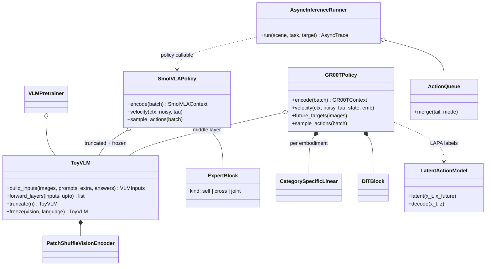
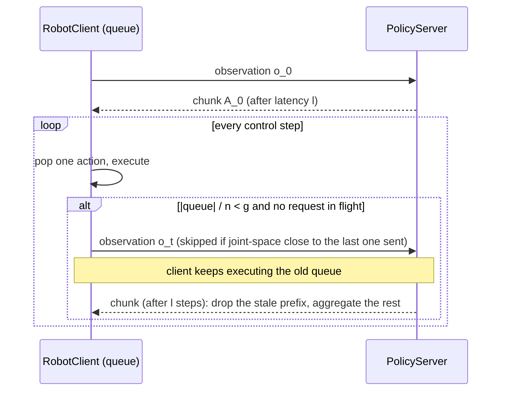

# SmolVLA and GR00T N1 / N1.5 in Hale-VLA

`src/Halo_VLA/open_vlas/` re-implements two open VLAs from first principles at a scale that trains on a laptop CPU, and
`notebooks/open_vlas/` explains each one step by step in the style of the Halos-lift lifting notebooks (numbered steps, a
diagram, a verification against a slow or by-hand computation, an end-to-end train/evaluate, controls, and recap + exercises).

| notebook | model | what it builds and measures |
|---|---|---|
| `smolvla_step_by_step.ipynb` | SmolVLA | pixel-shuffle token reduction, layer skipping (with a per-layer probe), the interleaved cross/self-attention expert, flow matching with a frozen VLM, the paper's ablations, and the **asynchronous inference** stack (queue, threshold `g`, latency, similarity filter, aggregation) |
| `groot_n1_n15_step_by_step.ipynb` | GR00T N1 / N1.5 | embodiment-specific MLPs, forward-time flow matching, the adaLN diffusion transformer, middle-layer VLM features, VQ-VAE latent actions, cross-embodiment pre-training and few-shot post-training, then the N1 → N1.5 ladder (frozen VLM, LayerNorm adapter, FLARE) |

## Sources

| model | source |
|---|---|
| SmolVLA | Shukor et al., *SmolVLA: A Vision-Language-Action Model for Affordable and Efficient Robotics*, 2025, [arXiv:2506.01844](https://arxiv.org/abs/2506.01844) (code: [LeRobot](https://github.com/huggingface/lerobot)) |
| GR00T N1 | NVIDIA, *GR00T N1: An Open Foundation Model for Generalist Humanoid Robots*, 2025, [arXiv:2503.14734](https://arxiv.org/abs/2503.14734) |
| FLARE | Zheng et al., *FLARE: Robot Learning with Implicit World Modeling*, 2025, [arXiv:2505.15659](https://arxiv.org/abs/2505.15659) |
| GR00T N1.5 | NVIDIA GEAR release notes, [research.nvidia.com/labs/gear/gr00t-n1_5](https://research.nvidia.com/labs/gear/gr00t-n1_5/) |

Numbers quoted in the notebooks (450M parameters / ~100M expert, 16 of 32 LLM layers, 64 visual tokens, chunk 50, 10 steps, 481 datasets / 22.9K
episodes / 10.6M frames, 200K steps; async 9.7 s vs 13.75 s; GR00T-N1-2B 2.2B parameters / 1.34B VLM, layer 12, H = 16, K = 4, 50K H100-hours;
FLARE weight 0.2, EMA 0.995) were read from the papers' full text. N1.5 changes are taken from the release notes (they do not name the VLM layer used).

## Structure



Shared pieces come from `pi_family` (toy world, `PiTrainer`, attention masks). The two policies share `ToyVLM`, `Attention`, the data layer
(`VLABatch`, `EmbodiedMixture`) and the closed-loop `EmbodiedEvaluator`; flow matching conventions differ on purpose (`SmolVLA` uses τ = 1 at noise like
LeRobot / π0, GR00T uses τ = 0 at noise like its paper, `ForwardFlow`).

## Asynchronous inference (SmolVLA, Algorithm 1)



## Caveats worth knowing

* Everything is **toy scale and single-seed**; the notebooks print what they measure and say where the toy disagrees with the paper.
* The toy VLM needs a short VQA pre-training stage (`vlm_pretraining.py`) before robot data, standing in for SmolVLM-2 / Eagle-2's web-scale pre-training.
* Measured, and reported rather than hidden: cross-attention alone matched or beat the paper's interleaved layout on this simple task; the latent-action
  labels (a VQ-VAE with scene-relative codes) did not give a reliable gain; FLARE did not add measurably over a frozen VLM; the decisive N1.5 ingredient in the
  toy was freezing the VLM (it preserves the grounding of a colour no robot demonstration targeted).
* The VQ-VAE collapses to one code unless the reconstruction loss is normalised by how much the frame changes and dead codes are re-initialised.

## Running

```bash
cd Hale-VLA
PYTHONPATH=.:src/Halo_VLA python -m pytest tests/test_open_vlas.py -o addopts=""
# notebooks: run from notebooks/open_vlas with a kernel that has torch + matplotlib (about 20 + 30 minutes on a laptop CPU)
```
