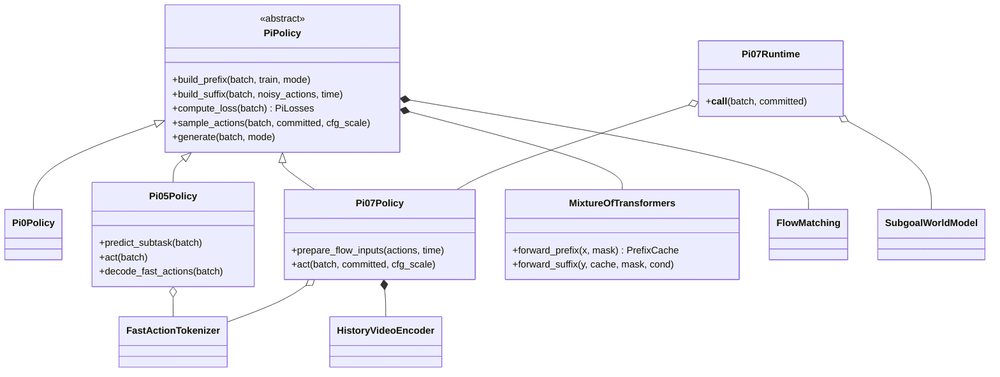
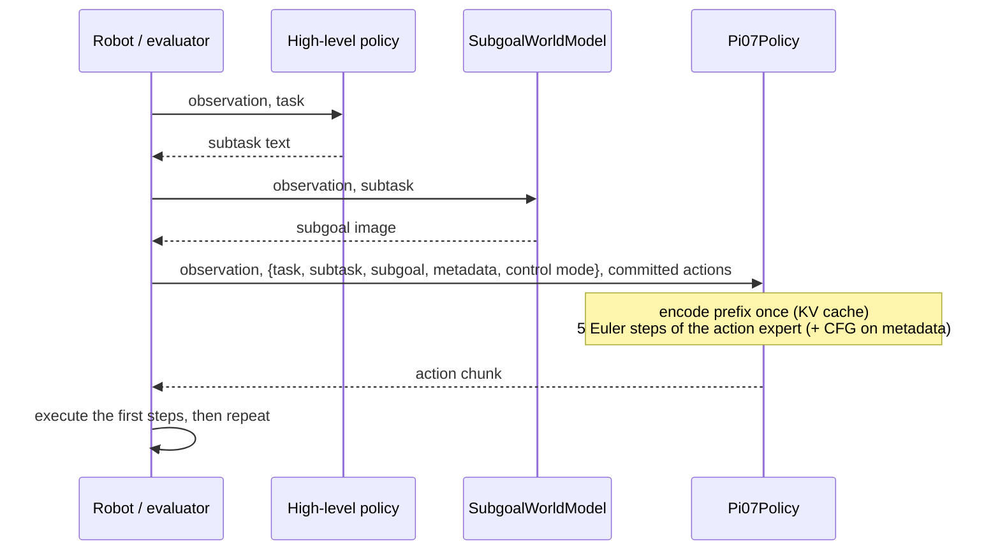

# The π family (π0, π0.5, π0.7) in Hale-VLA

`src/Halo_VLA/pi_family/` re-implements the three generations of Physical Intelligence's vision-language-action models from first
principles, at a scale that trains on a laptop CPU, and `notebooks/pi_family/` explains each one step by step in the style of the
Halos-lift lifting notebooks (one model per notebook).

| notebook | model | what it builds and measures |
|---|---|---|
| `pi0_step_by_step.ipynb` | π0 | block-causal attention, mixture of transformers with a cached prefix, flow matching, multimodal vs regression |
| `pi05_step_by_step.ipynb` | π0.5 | discrete state, FAST tokens, hierarchical subtask inference, adaRMSNorm, knowledge insulation |
| `pi07_step_by_step.ipynb` | π0.7 | prompt dropout, metadata/control-mode steering, CFG, MEM history, world-model subgoals, RTC |

## Sources

| model | source |
|---|---|
| π0 | Black et al., *π0: A Vision-Language-Action Flow Model for General Robot Control*, 2024, [arXiv:2410.24164](https://arxiv.org/abs/2410.24164) |
| π0.5 | Physical Intelligence, *π0.5: a Vision-Language-Action Model with Open-World Generalization*, 2025, [arXiv:2504.16054](https://arxiv.org/abs/2504.16054) |
| knowledge insulation | Driess et al., *Knowledge Insulating Vision-Language-Action Models*, 2025, [arXiv:2505.23705](https://arxiv.org/abs/2505.23705) |
| FAST | Pertsch et al., *FAST: Efficient Action Tokenization for Vision-Language-Action Models*, 2025, [arXiv:2501.09747](https://arxiv.org/abs/2501.09747) |
| π0.7 | Physical Intelligence, *π0.7: a Steerable Generalist Robotic Foundation Model*, technical report, April 2026, [blog](https://www.pi.website/blog/pi07), [PDF](https://www.pi.website/download/pi07.pdf) |

The π0.7 details (5B parameters: Gemma3-4B backbone with a 400M vision tower and an 860M action expert; prompt dropout rates; RTC delays
0-12; 5 denoising steps; CFG β in {1.3, 1.7, 2.2}) are taken from the technical report. Reference code for π0 / π0.5 is
[openpi](https://github.com/Physical-Intelligence/openpi).

## Structure



`PiPolicy` is a Template Method: `compute_loss`, `sample_actions` and `generate` are shared; each generation supplies only
`build_prefix` (what the backbone reads) and `build_suffix` (what the action expert reads). Attention is described entirely by
per-token `ar` bits (`masks.py`), so a new generation needs no new mask code.

## Inference sequence (π0.7, Algorithm 1)



## Toy world and caveats

`pi_family.toy` is a 32x32 point-robot world with scripted demonstrations in four styles (expert / careful / sloppy / mistake), joint and
end-effector control, and a closed-loop evaluator with simulated inference delay. Everything here is **toy scale and single-seed**; the
notebooks print what they measure. Two measured design notes worth knowing:

* the toy backbone needs a short VQA pre-training stage (`pretraining.py`) before robot data, standing in for the pre-trained VLM; without
  it flow-matching gradients alone take thousands of steps to teach it to ground a colour word;
* training-time RTC and past-state tokens did not help in this world (the latter causes copycat behaviour); the notebooks say so rather
  than hide it.

## Running

```bash
cd Hale-VLA
PYTHONPATH=.:src/Halo_VLA python -m pytest tests/test_pi_family.py -o addopts=""
# notebooks: run from notebooks/pi_family with a kernel that has torch + matplotlib
```
